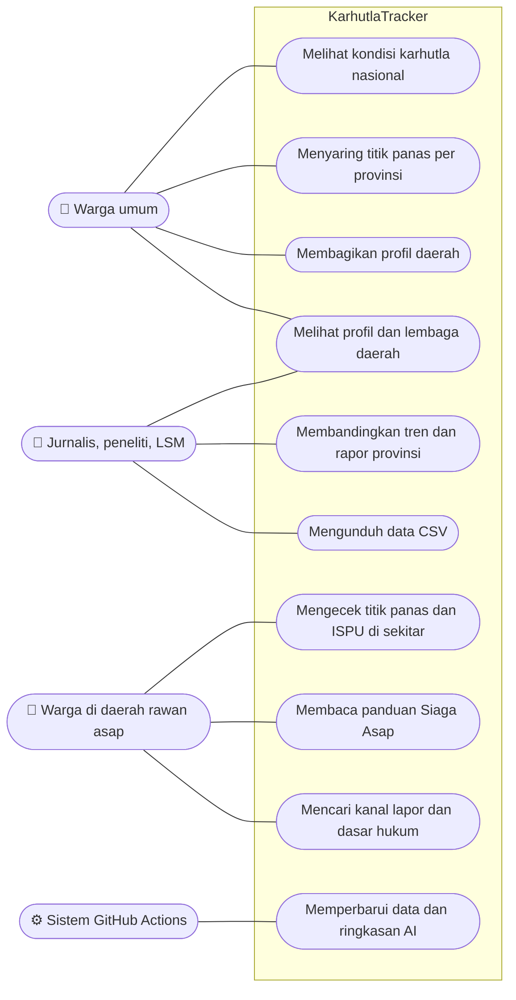
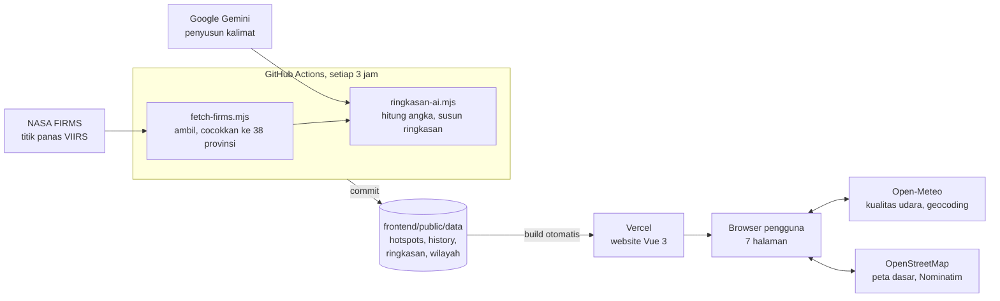

# KarhutlaTracker

**Titik api Indonesia, terpantau dari orbit.**

**Demo:** https://karhutla-tracker.vercel.app
**Video pitching:** (tautan YouTube)

Website transparansi titik panas kebakaran hutan dan lahan (karhutla) di Indonesia. KarhutlaTracker mengolah data satelit terbuka NASA menjadi peta, tren, rapor per provinsi, cek lokasi, dan panduan Siaga Asap yang bisa dipahami masyarakat umum. Semua angka berasal dari data asli, bukan simulasi, dan diperbarui otomatis setiap 3 jam.

**Subtema:** Open Government Data (Web In Action, MIA 2026)
**Tim:** KarhutlaOps

## Fitur
- **Beranda:** animasi titik panas 7 hari terakhir di peta Indonesia, angka utama, penanda data langsung, dan ringkasan harian nasional yang disusun AI.
- **Peta Titik Panas:** sebaran titik panas dengan filter provinsi dan tingkat kepercayaan, unduh data CSV, dan tautan langsung per provinsi (misalnya `/peta?p=papua-selatan`).
- **Tren:** perbandingan dengan minggu lalu dan tahun lalu, grafik 30/90/365 hari, provinsi dengan kenaikan terbesar, tabel 38 provinsi dengan **rapor 4 minggu** (membaik, memburuk, atau stabil), dan unduh CSV. Klik provinsi untuk membuka profilnya.
- **Profil Daerah:** ringkasan AI per provinsi, peringkat dan kepadatan titik panas per 1.000 km², tren harian, peta provinsi, daftar titik terbaru, lembaga penanggung jawab, kanal pelaporan (112, 113, SP4N-LAPOR!), dan tombol Bagikan.
- **Cek Sekitar:** titik panas dalam radius 50 km dan kualitas udara hari ini menurut ISPU. Lokasi bisa dari GPS, pencarian provinsi, kota, atau kabupaten (termasuk singkatan seperti "kalteng"), atau dipilih langsung di peta.
- **Siaga Asap:** panduan perlindungan diri sesuai kategori ISPU, masker dan pertolongan pertama, nomor darurat, serta **dasar hukum** tentang siapa yang wajib bertindak.
- **Tentang Data:** sumber data, cara kerja satelit, cara membaca tingkat kepercayaan, keterbatasan data, dan tanya jawab (FAQ).
- **Tema terang dan gelap**, responsif di HP, dan pratinjau tautan saat dibagikan.

## Use Case



| Aktor | Kebutuhan | Fitur yang dipakai |
| --- | --- | --- |
| Warga umum | Mengetahui kondisi karhutla di Indonesia hari ini | Beranda, Peta Titik Panas |
| Warga di daerah rawan asap | Tahu seberapa dekat titik panas dan apakah udara aman | Cek Sekitar, Siaga Asap |
| Kelompok rentan (anak, lansia, ibu hamil, penderita penyakit paru) | Langkah perlindungan diri sesuai tingkat asap | Siaga Asap (panduan per kategori ISPU, pertolongan pertama) |
| Warga yang melihat api atau asap | Tahu ke mana harus melapor | Profil Daerah (lembaga dan kanal), Siaga Asap (nomor darurat, LAPOR!) |
| Jurnalis, peneliti, dan LSM | Data dan perbandingan antardaerah yang bisa diperiksa ulang | Tren, rapor 4 minggu, Profil Daerah, unduh CSV |
| Warga yang ingin menagih tanggung jawab pemerintah | Bukti kondisi daerahnya dan dasar hukum kewajiban pemerintah | Profil Daerah (Bagikan), Siaga Asap (dasar hukum) |
| Sistem (GitHub Actions) | Memperbarui data dan ringkasan tanpa campur tangan manual | Pipeline data setiap 3 jam |

## Arsitektur


Website tidak memakai server atau database sendiri. Data diolah terjadwal oleh GitHub Actions, disimpan sebagai file JSON di repo, lalu Vercel membangun ulang website setiap kali data berubah. Kualitas udara dan nama tempat diambil langsung oleh browser saat pengguna memilih lokasi.

### Alur Data
1. `scripts/fetch-firms.mjs` mengambil titik panas dari NASA FIRMS, mencocokkannya ke 38 provinsi, dan menyimpan riwayat harian.
2. `scripts/ringkasan-ai.mjs` menghitung angka utama, lalu menyusun ringkasan harian nasional dan ringkasan per provinsi.
3. Workflow `.github/workflows/update-data.yml` menyimpan hasilnya ke `frontend/public/data`, lalu Vercel membangun ulang website.

`scripts/backfill-history.mjs` dipakai sekali untuk mengisi riwayat sekitar 400 hari ke belakang (pilihan *backfill* saat menjalankan workflow secara manual).

## Sumber Data
| Data | Sumber |
| --- | --- |
| Titik panas | NASA FIRMS, sensor VIIRS (Suomi NPP, NOAA-20, NOAA-21) |
| Luas wilayah provinsi | Badan Informasi Geospasial, Kepmendagri No. 300.2.2-2430/2025 |
| Batas provinsi | GeoJSON 38 provinsi (denyherianto, CC BY 4.0) dan garis pantai geoBoundaries |
| Kualitas udara (PM2.5) | Open-Meteo Air Quality (CAMS), dihitung ke ISPU sesuai PermenLHK P.14/2020 |
| Pencarian lokasi | Open-Meteo Geocoding |
| Nama tempat dari peta | Nominatim (OpenStreetMap) |
| Peta dasar | OpenStreetMap |
| Dasar hukum | JDIH BPK, Sekretariat Kabinet RI |

Satu tanggal hanya memakai satu satelit (Suomi NPP diutamakan) supaya titik yang sama tidak terhitung dua kali. Perbandingan mingguan memakai hari yang sudah lengkap, sedangkan Peta menampilkan data langsung sampai deteksi terakhir.

## Tech Stack
- **Frontend:** Vue 3, Vite, Vue Router, Tailwind CSS v4
- **Peta dan grafik:** Leaflet, Chart.js
- **Pengolahan data:** script Node.js yang dijalankan GitHub Actions setiap 3 jam
- **Ringkasan AI:** Google Gemini (model Flash) untuk ringkasan harian nasional dan ringkasan 38 provinsi. Semua angka dihitung sistem, AI hanya menyusun kalimat. Setiap ringkasan provinsi dicek otomatis: jika tidak memuat jumlah titik yang benar, atau jika AI gagal, dipakai ringkasan templat.
- **Deploy dan analitik:** Vercel, Vercel Web Analytics

## Struktur Direktori
```
karhutla-ops/
├── .github/workflows/
│   └── update-data.yml        # jadwal pembaruan data setiap 3 jam
├── scripts/                   # pengolahan data (Node.js)
│   ├── fetch-firms.mjs        # ambil titik panas NASA FIRMS, cocokkan ke provinsi
│   ├── ringkasan-ai.mjs       # angka utama dan ringkasan AI (nasional dan per provinsi)
│   ├── backfill-history.mjs   # isi riwayat sekitar 400 hari (sekali jalan)
│   ├── generate-sample.mjs    # data contoh untuk pengembangan awal
│   ├── lib/wilayah.mjs        # pencocokan koordinat ke provinsi
│   └── data/                  # batas provinsi, garis pantai, luas resmi BIG
└── frontend/                  # website (Vue 3 + Vite)
    ├── index.html
    ├── vercel.json            # pengaturan routing di Vercel
    ├── public/
    │   ├── data/              # hasil olahan bot: hotspots, history, ringkasan, wilayah, batas provinsi
    │   └── og.png             # gambar pratinjau tautan
    └── src/
        ├── main.js
        ├── App.vue
        ├── style.css          # warna, tema terang/gelap, komponen dasar
        ├── router/index.js    # daftar halaman
        ├── pages/             # Home, Dashboard (Peta), Trends, Region (Profil Daerah),
        │                      # Nearby (Cek Sekitar), Siaga, About (Tentang Data)
        ├── components/        # Navbar, Footer, Logo, HotspotSky, DailyChart, StatCard
        ├── composables/       # useTheme, useReveal, useCountUp
        └── services/
            ├── hotspots.js    # memuat data titik panas, riwayat, dan ringkasan
            └── udara.js       # kualitas udara dan perhitungan ISPU
```

## Cara Menjalankan
1. Clone repo
   ```bash
   git clone https://github.com/IsmailYanuar/karhutla-ops.git
   cd karhutla-ops
   ```
2. Install dan jalankan frontend (data terbaru sudah ada di repo)
   ```bash
   cd frontend
   npm install
   npm run dev
   ```
3. Buka `http://localhost:5173`

### Memperbarui data sendiri (opsional)
Buat file `.env` di folder utama:
```
FIRMS_MAP_KEY=key_dari_firms.modaps.eosdis.nasa.gov
GEMINI_API_KEY=key_dari_aistudio.google.com
```
Lalu jalankan dari folder utama:
```bash
node scripts/fetch-firms.mjs
node scripts/ringkasan-ai.mjs
```
File `.env` jangan di-commit. Di GitHub, kedua key disimpan di **Settings > Secrets and variables > Actions**.

## Progress
- ✅ Pipeline data otomatis NASA FIRMS lewat GitHub Actions (setiap 3 jam, 3 satelit VIIRS)
- ✅ Riwayat harian sekitar 400 hari dan luas resmi provinsi dari BIG
- ✅ Beranda dengan animasi titik panas dan ringkasan AI harian
- ✅ Peta Titik Panas dengan filter provinsi dan tingkat kepercayaan
- ✅ Tren: perbandingan mingguan dan tahunan, tabel 38 provinsi, rapor 4 minggu
- ✅ Profil Daerah: ringkasan AI per provinsi, kepadatan per 1.000 km², tren provinsi, kanal pelaporan, tombol Bagikan
- ✅ Cek Sekitar: titik panas radius 50 km, kualitas udara ISPU, pilih lokasi di peta, cari provinsi
- ✅ Siaga Asap: panduan sesuai ISPU, pertolongan pertama, nomor darurat, dan dasar hukum
- ✅ Tentang Data dengan FAQ
- ✅ Unduh data (CSV) dari Peta, Tren, dan Profil Daerah
- ✅ Tema terang dan gelap, animasi saat scroll, responsif di HP

## Rencana Pengembangan
- Laporan warga dengan verifikasi, dicocokkan dengan data satelit, lengkap dengan tiket dan status tindak lanjut
- Asisten tanya jawab yang menjawab pertanyaan warga berdasarkan data di situs
- Aksesibilitas: ramah pembaca layar, navigasi keyboard, dan video bersubtitle
- Info posko kesehatan dan pembagian masker per daerah

## Tim
- Ismail Yanuar Anwas: Ketua, Developer
- Muhammad Falah Marzuq: Dokumentasi, Developer
- Rizki Faiq Akbar: Riset dan Konten, Developer